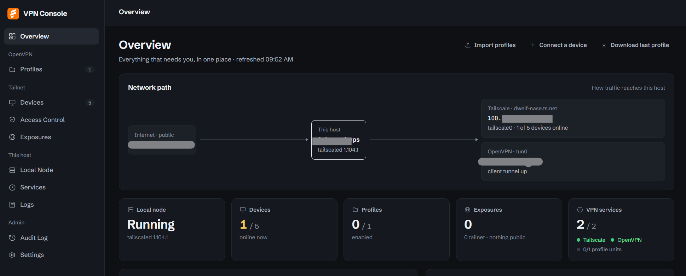
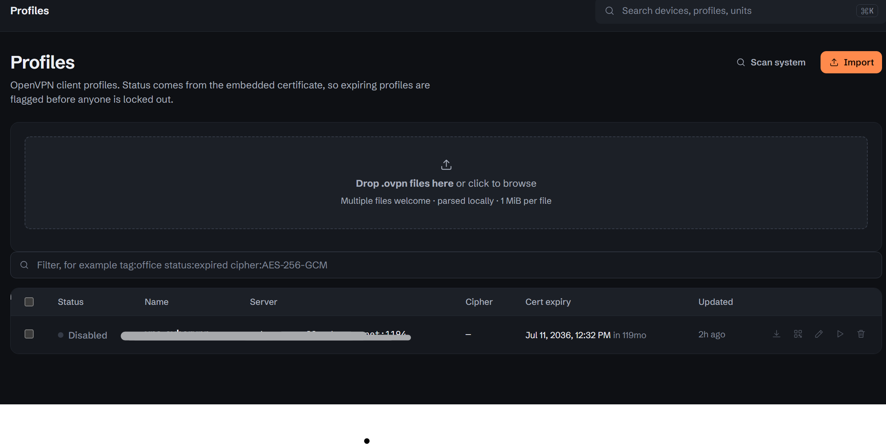
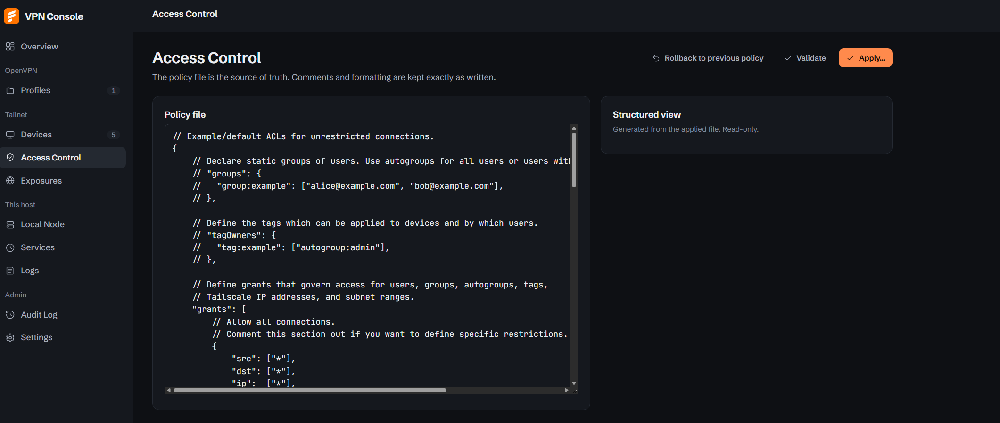
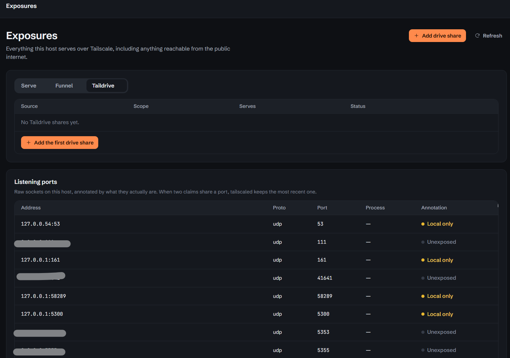
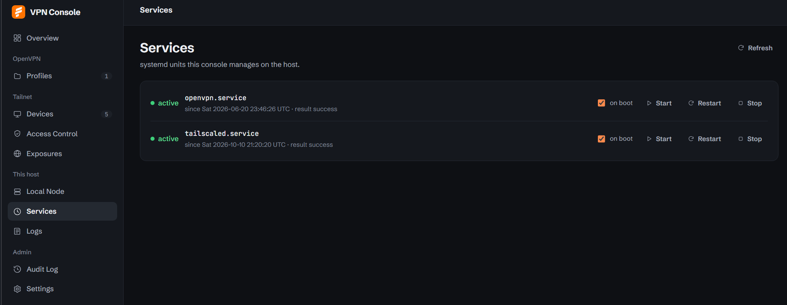
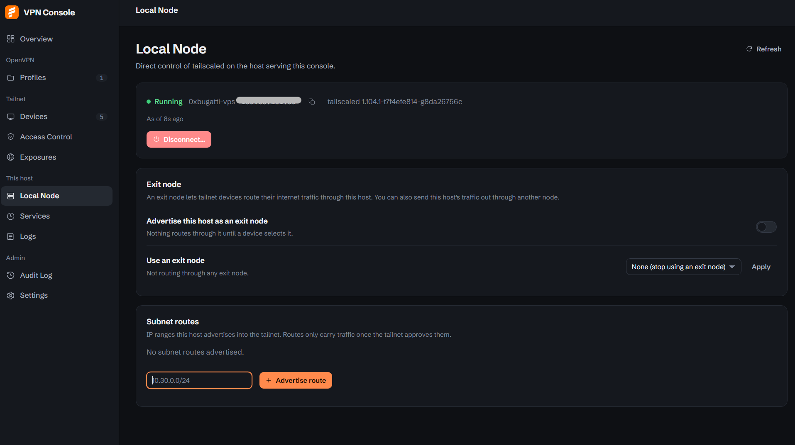

# vpn-console

A single-admin web console for OpenVPN and Tailscale, plus direct control of the
host that runs them. It replaces three separate places you'd normally go:
your `.ovpn` file collection, the Tailscale admin panel, and an SSH session for
`systemctl` and `journalctl`. One login, one audit trail, one view of whether
anything is broken.

No user accounts, no roles, no Node build step. A single admin password gates
a static SPA (plain ES modules, no bundler) talking to a thin FastAPI backend
in one container.



## What it manages

### Profiles: your OpenVPN `.ovpn` library

Drag and drop `.ovpn` files in (or scan the host's usual config locations) and
the console parses the embedded certificate to tell you which ones are valid,
expiring, expired, or unparsable, before anyone gets locked out by a cert
nobody noticed had aged out. Each profile supports download, a QR code (URL
mode or full embedded config), edit-with-undo, and expiring share links
(one-time or timed, revocable).



### Devices and Access Control: your tailnet

Device inventory comes straight from the Tailscale cloud API, with token
search (`is:unapproved tag:server !os:ios` works the way you'd expect from
the Tailscale admin console). Approval, key expiry, and deletion all go
through friction tiers, so a destructive action needs a deliberate second
step, not just a misclick.

The ACL editor works on the policy file directly: comments and formatting are
preserved exactly as written, because the file *is* the source of truth, not
a generated representation of it. Validate, diff against the live policy,
apply, or roll back to the previous version.



### Exposures: everything this host serves

One page for Serve, Funnel, and Taildrive, plus a raw listening-ports table
read straight from the kernel and annotated with what's bound there:
local-only, tailnet-only, or open to the public internet. If two things claim
the same port, you see that conflict instead of guessing at it later.



### This host: Local Node and Services

Local Node talks to `tailscaled` directly: connect or disconnect, advertise
or stop advertising subnet routes, pick an exit node or offer this host as
one. Services lists the systemd units the console manages (OpenVPN,
`tailscaled`, and anything else you configure), each with start, stop,
restart, and an on-boot toggle, read through bind-mounted sockets rather than
anything running inside the container.





### Logs and Audit

Logs streams from `journald` with a severity and text filter. Audit is
append-only. SQLite triggers block `UPDATE` and `DELETE` on the table at the
database level, so "append-only" is enforced below the API, not just
convention in the code above it. Every mutation lands there, including
undos and failures, with filters and a JSON export.

## Security model

One admin password is the whole access-control story. There's no second
account to create, lock out, or misconfigure. The password hashes with
`scrypt` (stdlib, no dependency) and an app-start bootstrap step lets you
change `ADMIN_PASSWORD` in the environment and have it take effect on next
start.

**Login links** are a separate mechanism for signing in with a URL instead of
typing the password: `/login?token=...`. The token is a different secret
from the password entirely, so a leaked link never exposes the password and
can be revoked on its own without touching anything else. Only a SHA-256
digest of it is ever stored, compared with `hmac.compare_digest` so the check
runs in constant time. It shares the same per-IP rate limiter as password
login, every attempt is audited (`method=login_link`, never the token
itself), and the console warns you if it's being reached over plain HTTP on
a non-local address, since the token rides in the URL and plain HTTP puts it
in every proxy and access log between you and the server.

Every mutating action, not just login, runs through a friction tier before it
takes effect: a simple `confirm` flag for routine changes, `typed_confirm`
(you type the resource's name back) for destructive ones, and `lan_ack` for
anything that could cut off your own access, like disconnecting `tailscaled`
on the host you're managing it from. Skip the required field and the API
returns `409`, not a silent no-op.

Each subsystem (the Tailscale API, the local `tailscaled` socket, systemd)
reports its own health independently, and a broken subsystem shows as broken.
If `tscloud` is unreachable, device and ACL pages say so and block mutations
rather than serving stale cached data as if it were current. This is a
deliberate project-wide stance, not an edge case someone happened to handle:
fail loud, never fail quiet.

`.ovpn` files are stored in plain text in the data directory. That's an
explicit decision, not an oversight, because the console needs to read the
embedded certificate and serve the file back on demand. Treat the data
directory and its backups the way you'd treat the `.ovpn` files themselves.

## Architecture

The frontend is hand-written ES modules with no bundler and no framework:
`server/static/app.js` holds routing, the API client, and shared UI helpers;
each page lives in `server/static/pages/`. Everything the frontend needs
ships in the image, including the two vendored fonts, so the whole thing
works air-gapped.

The backend is FastAPI, structured around **adapters**: Tailscale cloud API,
local `tailscaled` socket plus CLI, and systemd/journald, each behind an
interface with a fake implementation for tests. Set `VPNCONSOLE_ADAPTERS=fake`
and the entire UI runs against seeded, deterministic data, zero live systems
touched, which is also how the test suite runs without ever reaching your
actual tailnet. 178 tests cover unit, contract, and integration levels,
pinned against recorded API response shapes rather than live calls.

Real deployments run the container with `network_mode: host`, `pid: host`,
and `cgroup: host`. That's not incidental: systemd's `PID 1` admits
`systemctl` clients by cgroup membership, so a container cgroup reads as
foreign and gets rejected without it, and host PID namespace is what lets the
Listening ports table show real process names instead of a container-local
PID that means nothing on the host. The container never runs its own
`tailscaled`; the `tailscale` CLI inside it talks to the host daemon over a
bind-mounted socket.

## Run the tests

```sh
uv sync --dev && uv run pytest          # 178 tests, no live systems needed
# or plain pip:
pip install "fastapi>=0.115" "uvicorn>=0.30" "httpx>=0.27" \
            "cryptography>=43.0" "segno>=1.6" "python-multipart>=0.0.32" pytest
python -m pytest
```

## Try it in fake mode

A seeded scenario (an expired cert, an unapproved device, a failed unit, a
public exposure) runs the whole UI with nothing live behind it:

```sh
VPNCONSOLE_ADAPTERS=fake ADMIN_PASSWORD=dev uvicorn server.app:app --port 8337
# open http://localhost:8337 and sign in with `dev`
```

A longer tour, exercising most of what's on the page: import the sample
files in `tests/fixtures/ovpn/*.ovpn` · open the QR modal · create and then
revoke a
share link · search devices with `is:unapproved` · run a device through the
approve or expire friction ladder · validate, diff, apply, and roll back an
ACL change · try disconnecting Local Node and see the LAN-ack step · hit the
Funnel port-collision warning on Exposures · restart a service and watch the
status update · filter Logs and tail it live · filter and export Audit ·
change the password. The full scripted version is in
[specs/001-unified-vpn-dashboard/quickstart.md](specs/001-unified-vpn-dashboard/quickstart.md).

## Deploy

One container on the host that runs `tailscaled`, nothing else: no database,
no Node, no reverse proxy required. Full instructions, including every
bind mount and what it's for, are in
[deploy/README-deploy.md](deploy/README-deploy.md). The short version:

```sh
cd deploy
cat > .env <<'EOF'
ADMIN_PASSWORD=<choose a long password>
EOF
chmod 600 .env
docker compose up -d --build
```

The console binds `127.0.0.1` by default. Reach it over an SSH tunnel
(`ssh -N -L 8090:localhost:8090 root@<host>`), or put it behind your own
reverse proxy, or set `VPNCONSOLE_BIND=0.0.0.0` in `.env` if you deliberately
want it on every interface. Don't put it on Tailscale Funnel by accident:
exposing the console itself to the public internet is something you'd do on
purpose through its own Exposures page, not something that should happen as
a side effect of a deploy flag.

### Behind a reverse proxy, on a sub-path

The frontend resolves its own API base from wherever the browser loaded
`app.js` from (`import.meta.url`, not a hardcoded `/api`), so mounting
it at a path like `https://example.com/vpn/` instead of its own subdomain
needs no build step and no extra frontend config. The one thing a proxy
needs to add is a header so server-rendered redirects, like the one the
login-link flow issues after a token verifies, land on the right prefix
instead of bouncing to the domain root:

```nginx
location /vpn/ {
    proxy_pass http://127.0.0.1:8090/;
    proxy_set_header Host $host;
    proxy_set_header X-Forwarded-Proto $scheme;
    proxy_set_header X-Forwarded-Prefix /vpn;
}
```

Without that header the console still works at its own origin exactly as
before. The prefix is read per request, not baked in at startup, so the same
running instance answers correctly whether it's reached directly or through
the proxy.

## Configuration

| Variable | Meaning |
|---|---|
| `ADMIN_PASSWORD` (or `ADMIN_PASSWORD_FILE`) | the single gate; required |
| `TS_API_TOKEN` | Tailscale cloud API token; env wins over one stored in Settings; never logged |
| `TS_TAILNET` | tailnet name, `-` for default |
| `VPNCONSOLE_BIND` | uvicorn bind address, default `127.0.0.1` (compose/deploy level) |
| `VPNCONSOLE_PORT` | uvicorn port, default `8090` |
| `VPNCONSOLE_DATA` | data directory (SQLite, plain `.ovpn` store, audit log), default `./data` |
| `VPNCONSOLE_SESSION_SECRET` | pin session signing across restarts; random per instance otherwise |
| `VPNCONSOLE_ADAPTERS` | `real` (default) or `fake` |
| `VPNCONSOLE_SCAN_DIRS` | comma-separated read-only mounts the Profiles "Scan system" feature walks |
| `VPNCONSOLE_LOGIN_TOKEN` | set a login-link token from the environment instead of generating one in Settings; 24+ characters |
| `VPNCONSOLE_POLL_STATUS_S` / `VPNCONSOLE_POLL_LISTS_S` | UI poll intervals, default `10` / `60` |

## Project layout

```
server/            FastAPI app + adapters (tscloud / tslocal / host) + audit
server/static/     hand-written SPA (ES modules, no build step)
tests/             unit + contract + integration (fake adapters)
deploy/            Dockerfile, compose.yaml, deploy guide
specs/             spec-kit feature: spec, plan, research, tasks, quickstart
design-system/     MASTER.md, the design language every screen follows
docs/screenshots/  the images in this README
```

## Design

The interface follows a written design system
([design-system/MASTER.md](design-system/MASTER.md)): flat white panels on a
cool off-white ground in light mode, one burnt-orange accent reserved for
things you can act on (buttons, links, focus, toggles), everything else in
ink and gray. No glow on buttons or status dots, no gradient orbs, no
invented logo; the mark is Firezone's own favicon, used flat and credited as
exactly what it is. Dark mode is the same system re-stepped, not a separate
design. Two fonts, Schibsted Grotesk for the interface and JetBrains Mono
for anything that's a machine value (addresses, versions, unit names), both
vendored locally.
